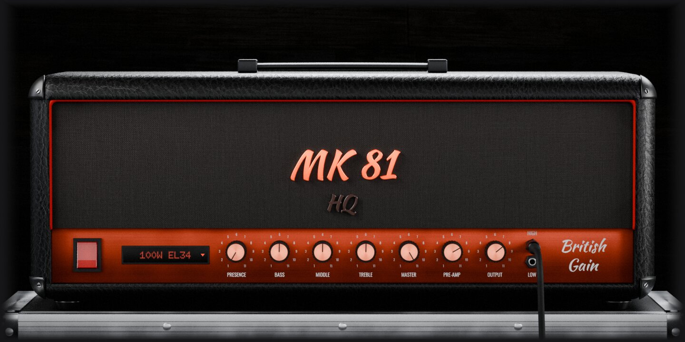
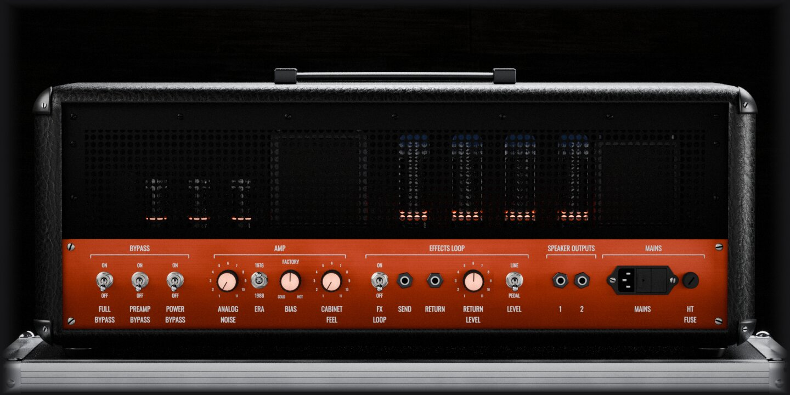

# MK 81

<p align="center"></p>
<p align="center"></p>

MK 81 is a **British valve guitar amplifier head** that runs on Linux as an **LV2** plugin, with its own rendered
interface. It is the single-channel, master-volume lead head of the early 1980s: two volume stages in the preamp, a
passive tone stack, and a push-pull power stage that sags, compresses and growls when it is driven. It is modelled from
the circuit rather than captured from a unit or fitted to a curve: every stage is solved from its components and
checked against a circuit simulator.

This is an independent product and is **not affiliated with, endorsed by, or connected to any amplifier manufacturer**.

---

> **Full disclosure: This plugin was vibe-coded.**
>
> MK 81 was developed by a musician/audio engineer ([NiLace](https://github.com/NiLace)) directing [Claude](https://claude.ai) (Anthropic's AI) through natural language conversation. The author described what the plugin should do, how it should sound, and how it should look. Claude wrote the C code, the DSP algorithms, the UI rendering, the build system, and this README.
>
> The author is not a professional programmer, though he can read C. Every line of code in this project was generated by AI, then tested and validated by the author in real-world audio production with [Ardour](https://ardour.org) on Linux.
>
> If AI-generated code is a concern for you, this is your notice. The plugin works and it sounds good — but you should know how it was made.

---

## What it is

In the mid-1970s a British maker gave its loud, simple valve head a **master volume**. Until then, getting an amplifier
to distort meant turning it up until the power valves gave in, at a volume few rooms could stand. The new head put a
second gain stage in the preamp and a Master control before the power amp, so the preamp could be driven into
saturation at any volume, and the power stage still pushed when the room allowed it. At the start of the 1980s that
head, in a new livery, became the one everybody wanted.

That head is the sound of hard rock and heavy metal in the 1980s. It is on the big riffs of the decade, on the solos
that sing and sustain, and behind the tight, palm-muted rhythm parts of thrash. It owes its reputation to its
**midrange**, which cuts through a band where scooped amps disappear, and to the way it **responds**: roll the guitar's
volume back and it cleans up, dig in and it snarls, and the power stage compresses and blooms under a hard-hit chord.
There is one channel and no effects on it: the sound is the guitar, the amp and how hard you play.

## The versions

The amp comes in five versions, picked from the model display on the front panel:

- **100W EL34** — four EL34 power valves: the classic, tight and bright, with a lot of clean headroom in the power stage.
- **100W 6550** — four 6550, the export specification: firmer lows, more headroom, a harder edge.
- **50W EL34** — two EL34 and its own output transformer: it breaks up earlier and compresses more, the power stage
  joins in sooner.
- **50W 6550** — the 50 W voicing with the export valves.
- **100W EL34 RI** — the later reissue: different tone-control pots, one capacitor fewer in the first stage, its own
  mains transformer, and a built-in **effects loop card** with a LINE / PEDAL level switch.

The preamp is the same in the four original versions, as it was in the hardware. On the 100 W originals a switch on the
back picks the **era** of the power supply: the earlier production (1976) or the later one (1988), which sag
differently under a hard-hit chord.

## How it is modelled

- The **whole amplifier is one circuit, solved sample by sample**: the preamp's triodes with their grid current, the
  interactive tone stack, the phase inverter, the push-pull power valves with their output transformer and global
  negative feedback, the power supply with its rectifier and its sag, and the reactive load of a real 4x12 cabinet.
  Every stage loads the one before it, as in the amplifier, so the controls behave the way the hardware's do.
- The equations are **generated from the schematic's netlist** (a nodal analysis solved by Newton's method each
  sample), not tuned by ear or fitted to recordings of somebody's unit. The valve models are our own, fitted to the
  published datasheet curves.
- The arbiter throughout development was **ngspice** running the same netlist: not a listening test, and not a
  capture of somebody's unit.

The circuit runs at **2x internally** (4x with HQ, see below), so what the valves create does not fold back into the
audible band. That costs **85 samples** of latency at every session rate (1.77 ms at 48 kHz), the same whether HQ is on
or off; the plugin reports it and the host compensates.

## The front panel

Every control is on the panel, and every one is also a plugin parameter your host can automate. Click the grille cloth
to turn the amp round; click the vent at the back to turn it back. Rest the pointer on a control to see what it does
and its value. Drag a knob up or down (hold Shift for fine steps), use the mouse wheel, or double-click it to return it
to its default.

- **Power** — the amp on and off. Off, the guitar passes through clean and the amp stops using CPU.
- **Model display** — click it to pick one of the five versions.
- **HIGH / LOW inputs** — click the free jack to move the cable. HIGH is the full-gain input; LOW has less gain and a
  softer, rounder response, for hot pickups or a cleaner sound.
- **Pre-Amp** — the preamp's gain: clean or edge-of-breakup at the bottom, through crunch to full saturation, with more
  sustain, more compression and a thicker midrange.
- **Treble · Middle · Bass** — the passive tone stack after the preamp's gain stages. They interact, as on the hardware:
  changing one changes how much the others do. Middle down gives the scooped sound; up, the honk that cuts through a band.
- **Master** — the level into the power amp. Low, the distortion is the preamp's alone; turned up, the power valves
  saturate and the supply sags: more compression, more low-end bloom, attacks that jump out of the note.
- **Presence** — a treble lift inside the power amp's feedback loop, for bite and upper-midrange sparkle. It grows with
  the Master.

## The back panel

- **Era** — the power supply of the earlier (1976) or later (1988) production, on the 100 W originals: how much the amp
  squashes and recovers under a hard-hit chord. On the 50 W head and the reissue it has no effect, and its lever sits in
  the middle.
- **Bias** — the power valves' idle current, from cold through factory to hot. Colder sounds tighter and thinner;
  hotter, fuller and smoother.
- **FX Loop**, **Return Level** and **LEVEL** — the reissue's effects loop, between the preamp and the power amp, always
  in series. Its signal leaves on the plugin's **Send** output and comes back on its **Return** input: route them to
  your effects in the host. PEDAL (the default) sends a guitar-level signal, right for stomp boxes; LINE a hot one, for
  rack effects.

### Our mods

The original amp has nothing else on it. Everything below is **ours** — options the hardware does not have — and each
one says which position sounds like the stock amp:

| Control | What it does | Stock amp |
|---|---|---|
| **Output** (front) | The level after the amp, from −24 to +12 dB, without changing its tone: push the Master for the power-amp sound, then bring the result down here for the mix. | **0 dB** |
| **HQ** (the letters under the badge) | The amp computed at 4x oversampling instead of 2x, a little closer to the circuit, at a higher CPU cost. Pressed, the letters sink in and light up with the badge. | — (both model the same circuit; off, the default, is lighter) |
| **Cabinet Feel** | The load the power amp drives: at 0 a flat test resistor, at 1 the impedance of a real 4x12, whose resonance fattens the lows and whose rising impedance brightens the top. It changes how the amp itself behaves; it does not replace a cabinet IR. | **1**, a real cabinet (the default is 0, the flat resistor) |
| **Analog Noise** | The hum and hiss of a real amp, together, as loud as on the original at 1. | the real amp always hums and hisses; here it is **0**, silent, by default |
| **Full Bypass** | The dry guitar, while the amp keeps running, so switching back is instant and click-free: for comparing. | off |
| **Preamp Bypass** | The input straight into the power amp: for a preamp pedal or another preamp in front. | off |
| **Power Bypass** | The preamp alone, at its own level: for feeding another power amp. | off |
| **The effects loop on the originals** | The reissue's loop card, on the four original versions too. | the originals have **no loop**: leave FX Loop off |

## More gain: a boost in front

As guitarists do with the hardware, you can put a boost or overdrive plugin **in front of** MK 81 to drive its input
harder, for more gain and sustain. For example [Valve Howler](https://github.com/NiLace/ValveHowler), our own
circuit-modelled overdrive: placed before MK 81 on the same track, it pushes the preamp further into saturation and adds
its midrange hump. With its Drive low it works as a clean boost; turned up, it stacks its own clipping on the amp's.

## Input level

MK 81 reads its input as **volts at the amp's input jack**, with no scaling: a sample of 1.0 (0 dBFS) is 1 V peak at
the jack. Your audio interface's input gain sets how hard the guitar hits the first valve, as the guitar's own output
does on the real amp. A DI recorded with its peaks around −10 dBFS is a guitar played normally; a boost or overdrive in
front takes it up to about 0 dBFS. There is no "ideal" level: a hotter input means more preamp distortion, as on the
hardware.

## What it doesn't model

Stated here so it doesn't have to be inferred:

- **The speaker cabinet's sound.** MK 81 outputs what the amp sends to its speaker: put a cabinet impulse response after
  it with any IR loader. The electrical side of the speaker — the load that changes how the power stage distorts — is
  modelled, and Cabinet Feel moves it.
- **The heaters' hum** (the leakage from a valve's heater into its cathode), which is on no schematic. The supply's
  ripple hum is modelled.
- **The loading of your guitar's pickups.** That happens in the analogue domain before the converter, so no plugin can
  do it.
- **Stereo.** The original is a mono amp, and so is this one.

## To do

- **More of the family.** The same maker built other heads before and after this one; they are planned as further
  plugins, each modelled from its own circuit.


## Installing it

The easy way — no compiler needed. Grab the prebuilt bundle from the
[**Releases**](https://github.com/NiLace/MK81/releases) page and drop it into your personal LV2 folder:

```sh
mkdir -p ~/.lv2
tar -xzf mk81.lv2.tar.gz -C ~/.lv2/
```

That leaves `mk81.lv2/` under `~/.lv2/`. Restart your host (or rescan plugins) and it shows up as **MK 81** — in
**Ardour** or any other LV2 host (Carla, Qtractor, Zrythm, REAPER with LV2…). Put it on a **mono** track; the effects
loop's send and return appear as extra audio ports. To uninstall, delete the folder. If your host scans a different
location, extract there instead (the system-wide path is usually `/usr/lib/lv2` or `/usr/local/lib/lv2`).

The bundle is a 64-bit x86 build for Linux, for generic x86-64: no AVX2 or other newer instructions are required. What
changed in each version is listed in [`CHANGELOG.md`](CHANGELOG.md).

## Building from source

Linux, a C11 compiler, and the LV2, Cairo, X11 and FreeType development headers (`liblv2-dev`, `libcairo2-dev`,
`libx11-dev`, `libfreetype-dev` on Debian).

```sh
make plugin       # builds build/mk81.lv2
make install      # installs it to ~/.lv2 (atomically: safe while a host has it loaded)
```

## Third-party components

- **Pugl** (`deps/pugl/`) — the windowing library, by David Robillard, under the ISC licence.
- **Fonts** (`gui/fonts/`) — Doto (© The Doto Project Authors) and Oswald, under the SIL Open Font License 1.1 (full
  texts beside them). They stay under the OFL and are not relicensed under the AGPL. They travel inside the bundle
  because the interface draws the model display, the live values and the help cards with them directly.
- **Interface images** (`gui/photo/`) — renders of our own 3D scene of the amp, lit with the `studio_small_08` HDRI
  from [Poly Haven](https://polyhaven.com/a/studio_small_08) (CC0), with the Leather031, Fabric035 and Planks023B
  textures from [ambientCG](https://ambientcg.com) (CC0). The lettering in the renders is set in Oswald, Kaushan Script
  and Doto (SIL Open Font License 1.1) and Liberation Sans (SIL Open Font License 1.1).

## How this was made, and the license

This plugin was built mainly with **Claude Code** (Anthropic's AI coding agent), working from my direction on the DSP,
the design, and the testing. I can read C, but I have not reviewed every line by hand — so please treat it accordingly:

- **No warranty.** It works in my own testing, but it carries no guarantees of any kind.
- **No support.** This is a personal project; I can't promise help, fixes, or answers.
- **Help is welcome.** If you read code, spot bugs, or want to improve it, review and contributions are genuinely
  appreciated — that's a big part of why it's open.

Released under the **GNU Affero General Public License v3.0, that version only** (`AGPL-3.0-only`) — see
[`LICENSE`](LICENSE). You may use it, study it, modify it and sell it; what nobody may do is close it: any
version you distribute, or let others use over a network, has to come with its complete source under this same
licence. The third-party parts listed above keep their own licences. Contributions are welcome — see
[`CONTRIBUTING.md`](CONTRIBUTING.md).

## Author

Made by **NL Sounds** — <https://github.com/NiLace> · nilace@nylarea.com
