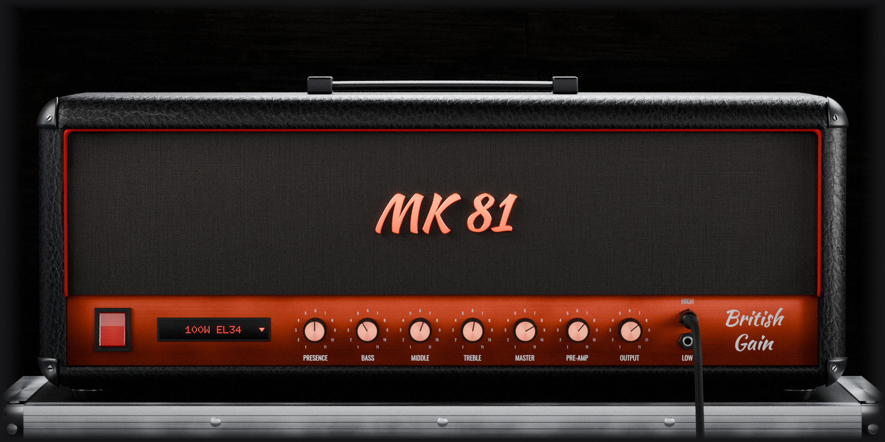
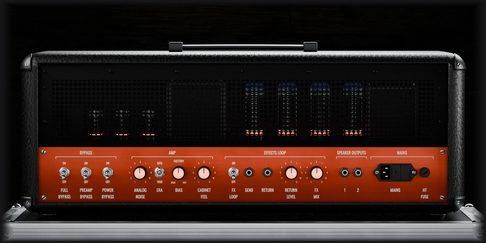

# MK 81

<p align="center"></p>
<p align="center"></p>

MK 81 is a **British valve guitar amplifier head** of the early 1980s that runs on Linux as an **LV2** plugin, with its
own rendered interface. It is the single-channel, master-volume lead head that defined the sound of hard rock and
heavy metal: two volume stages in the preamp, a passive tone stack, and a push-pull power stage that sags, compresses
and growls when it is driven. It is modelled from the circuit rather than captured from a unit or fitted to a curve.

This is an independent product and is **not affiliated with, endorsed by, or connected to any amplifier manufacturer**.

---

> **Full disclosure: This plugin was vibe-coded.**
>
> MK 81 was developed by a musician/audio engineer ([NiLace](https://github.com/NiLace)) directing [Claude](https://claude.ai) (Anthropic's AI) through natural language conversation. The author described what the plugin should do, how it should sound, and how it should look. Claude wrote the C code, the DSP algorithms, the UI rendering, the build system, and this README.
>
> The author is not a professional programmer, though he can read C. Every line of code in this project was generated by AI, then tested and validated by the author in real-world audio production with [Ardour](https://ardour.org) on Linux.
>
> If AI-generated code is a concern for you, this is your notice. The plugin works and it sounds good — but you should know how it was made.

---

## What it is

The amp comes in the four versions the same design was built in, picked from the display on the front panel:

| Version | Power valves | What changes |
|---|---|---|
| **100W EL34** | four EL34 | the classic: tight, bright, a lot of clean headroom in the power stage |
| **100W 6550** | four 6550 | the export spec: firmer lows, more headroom, a harder edge |
| **50W EL34** | two EL34 | breaks up earlier and compresses more: the power stage joins in sooner |
| **50W 6550** | two 6550 | the 50 W voicing with the export valves |

The preamp is the same in all four, as it was in the hardware. A switch on the back picks the **era** of the power
supply: the earlier production (1976) or the later one (1988), which sag differently under a hard-hit chord.

### Controls

Every control is on the panel, and every one is also a plugin parameter your host can automate. Click the grille
cloth to turn the amp round; click the vent at the back to turn it back. Rest the pointer on a control to see what it
does and its value; a knob shows its value in place of its name while you turn it. Drag a knob up or down (hold
Shift for fine steps), use the mouse wheel, or double-click it to return it to its default.

#### Front panel

| Control | What it does to the sound |
|---|---|
| **Power** | Switches the amp on and off. Off, the guitar passes through clean and the amp stops using CPU. |
| **Model display** | Click it to pick one of the four versions: 100W EL34, 100W 6550, 50W EL34, 50W 6550 (see the table above). |
| **HIGH / LOW inputs** | Click the free jack to move the cable. HIGH is the full-gain input; LOW has less gain and a softer, rounder response, for hot pickups or a cleaner sound. |
| **Pre-Amp** | The preamp's gain. Low settings are clean or edge-of-breakup; turning it up goes through crunch to full saturation, with more sustain and compression and a thicker midrange. |
| **Treble · Middle · Bass** | The passive tone stack, placed after the preamp's gain stages. The three controls interact, as on the hardware: changing one changes how much the others do. Middle down gives the scooped sound; up, the honk that cuts through a band. |
| **Master** | The level sent into the power amp. Low, the distortion comes from the preamp alone and the power amp stays clean. Turned up, the power valves saturate and the supply sags: more compression, more low-end bloom, and attacks that jump out of the note, as a cranked amp does. |
| **Presence** | A treble lift inside the power amp's feedback loop: adds bite and upper-midrange sparkle. It acts on the power amp, so it grows with the Master. |
| **Output** | The level after the amp, from −24 to +12 dB, without changing its tone. Push the Master for the power-amp sound, then bring the result back down here for the mix. |

#### Back panel

| Control | What it does to the sound |
|---|---|
| **Full Bypass** | Passes the dry guitar while the amp keeps running, so switching back is instant and click-free. Use it to compare. |
| **Preamp Bypass** | Skips the preamp: the input goes straight into the power amp. For a preamp pedal or another preamp in front. |
| **Power Bypass** | Skips the power amp: you hear the preamp alone, at its own level. For feeding another power amp. |
| **Analog Noise** | The hum and hiss of a real amp, together. At 0 the plugin is silent; at 1 they are as loud as on the original. |
| **Era** | The power supply of the earlier (1976) or later (1988) production. They sag differently under a hard-hit chord: how much the amp squashes and recovers. |
| **Bias** | The power valves' idle current, from cold through factory to hot. Colder sounds tighter and thinner; hotter, fuller and smoother. |
| **Cabinet Feel** | The load the power amp drives. At 0 it is a flat test resistor; at 1, the impedance of a real 4x12 cabinet, whose resonance fattens the lows and whose rising impedance brightens the top, as a real speaker makes the amp do. It does not replace a cabinet IR: it changes how the amp itself behaves. |
| **FX Loop** | Switches on the effects loop between the preamp and the power amp. Its signal leaves on the plugin's **Send** output and comes back on its **Return** input; route them to your effects in the host. |
| **Return Level** | The level of the effects return before it reaches the power amp, from 0 to 2 (1 = unity). |
| **FX Mix** | How much of the return reaches the power amp: 100 % puts the effects in series; lower settings blend them in parallel with the dry preamp signal. |

### More gain: a boost in front

As guitarists do with the hardware, you can put a boost or overdrive plugin **in front of** MK 81 to drive its input
harder, for more aggressive tones with much more gain and sustain. For example [Valve Howler](https://github.com/NiLace/ValveHowler),
our own circuit-modelled overdrive: placed before MK 81 in the same track, it pushes the preamp further into saturation
and adds its midrange hump. With its Drive low it works as a clean boost; turned up, it stacks its own clipping on the
amp's.

### What it does not do

There is **no speaker cabinet simulation** inside: MK 81 outputs what the amp sends to its speaker. Put a cabinet
impulse response after it with any IR loader. The electrical side of the speaker — the load that changes how the power
stage distorts — is modelled, and Cabinet Feel moves it.

## How it is modelled

- The **preamp** is the circuit solved sample by sample: the triodes with their grid current, the interactive tone
  stack, the split supply rail. Our own valve model, fitted to the published datasheet curves.
- The **power stage** (phase inverter, the push-pull pair with its output transformer and global negative feedback,
  the supply's sag, the reactive speaker load) is a small recurrent neural network, one per version, **trained against
  the exact circuit** solved at 16 times the sample rate — not against recordings of somebody's unit.
- The arbiter throughout development was **ngspice** running the same netlist: not a listening test, and not a
  capture of somebody's unit.

## Performance

About **10 % of one CPU thread per instance** at 48 kHz on an Intel i7-8700K. Reported
latency: **47 samples at 48 kHz**. Built for generic x86-64: no AVX2 or other newer instructions are required.

## Installing it

The easy way — no compiler needed. Grab the prebuilt bundle from the
[**Releases**](https://github.com/NiLace/MK81/releases) page and drop it into your personal LV2 folder:

```sh
mkdir -p ~/.lv2
tar -xzf mk81.lv2.tar.gz -C ~/.lv2/
```

That leaves `mk81.lv2/` under `~/.lv2/`. Restart your host (or rescan plugins) and it shows up as **MK 81** — in
**Ardour** or any other LV2 host (Carla, Qtractor, Zrythm, REAPER with LV2…). Put it on a **mono** track; the effects
loop's send and return appear as extra audio ports. To uninstall, delete the folder. If your host scans a different
location, extract there instead (the system-wide path is usually `/usr/lib/lv2` or `/usr/local/lib/lv2`).

The bundle is a 64-bit x86 build for Linux. What changed in each version is listed in [`CHANGELOG.md`](CHANGELOG.md).

## Building from source

Linux, a C11 compiler, and the LV2, Cairo, X11 and FreeType development headers.

```sh
make plugin       # builds build/mk81.lv2
make install      # installs it to ~/.lv2 (atomically: safe while a host has it loaded)
```

## Third-party components

- **Pugl** (`deps/pugl/`) — the windowing library, by David Robillard, under the ISC licence.
- **Fonts** (`gui/fonts/`) — Doto (© The Doto Project Authors) and Oswald, under the SIL Open Font License 1.1 (full
  texts beside them). They stay under the OFL and are not relicensed under the GPL. They travel inside the bundle
  because the interface draws the model display, the live values and the help cards with them directly.
- **Interface images** (`gui/photo/`) — renders of our own 3D scene of the amp, lit with the `studio_small_08` HDRI
  from [Poly Haven](https://polyhaven.com/a/studio_small_08) (CC0), with the Leather031, Fabric035 and Planks023B
  textures from [ambientCG](https://ambientcg.com) (CC0). The lettering in the renders is set in Oswald, Kaushan Script
  and Doto (SIL Open Font License 1.1) and Liberation Sans (SIL Open Font License 1.1).

## How this was made, and the license

This plugin was built mainly with **Claude Code** (Anthropic's AI coding agent), working from my direction on the DSP,
the design, and the testing. I can read C, but I have not reviewed every line by hand — so please treat it accordingly:

- **No warranty.** It works in my own testing, but it carries no guarantees of any kind.
- **No support.** This is a personal project; I can't promise help, fixes, or answers.
- **Help is welcome.** If you read code, spot bugs, or want to improve it, review and contributions are genuinely
  appreciated — that's a big part of why it's open.

Released under the **GNU General Public License v3.0 or later** — see [`LICENSE`](LICENSE).

## Author

Made by **NL Sounds** — <https://github.com/NiLace> · nilace@nylarea.com
